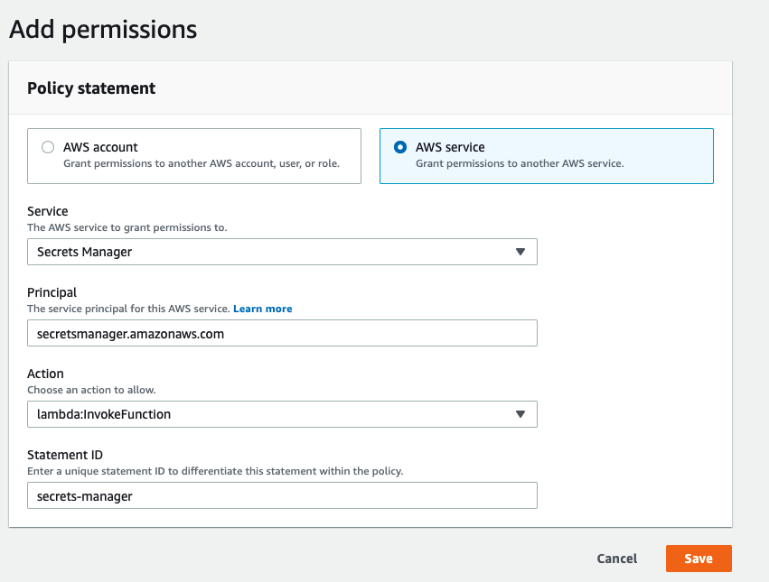
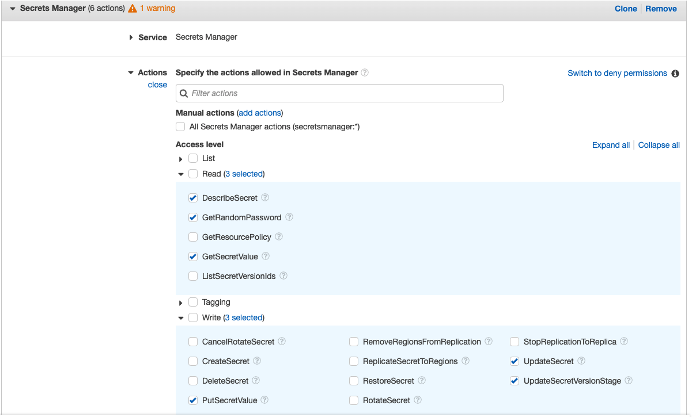

OSU Search is an application designed for searching through OSU for various pages and other pieces of content related to Oregon State. It can also show people and places of OSU. It can be accessed at [search.oregonstate.edu](https://search.oregonstate.edu).

This codebase is a serverless application model, meaning there is no "backend". To access third-party APIs and other endpoints requiring credentials, this application makes calls to AWS Lambda functions that do the work.

The front end is built with [Vite](https://vite.dev) and tested with [Vitest](https://vitest.dev).

## Requirements

- Node.js 26 (see `.nvmrc`; run `nvm use`)
- Yarn 1
- A `FONTAWESOME_TOKEN` environment variable for installing the Font Awesome Pro packages

The Lambda functions are deployed with [osls](https://github.com/oss-serverless/osls), the open-source continuation of Serverless Framework v3, and run on the `nodejs26.x` runtime.

## Lambda Functions

### First time deployment to AWS
There is one manual step required when deploying to AWS for the FIRST time. 
1. Deploy the lambda functions using `yarn deploy-lambda`
2. In a browser navigate to the `updateApigeeToken` lambda function
3. Go to Configuration -> Permissions -> Resource-based policy -> Add permission

4. Save and return to the Permissions configuration
5. Click the link under `Execution Role` to view the functions role
6. Attach a new policy with the following permissions

## Available Scripts

In the project directory, you can run:

### `yarn start`

Runs the app in the development mode. 
Open [http://localhost:3000](http://localhost:3000) to view it in the browser.

The page will reload if you make edits.

### `yarn test`

Launches the test runner in the interactive watch mode. In CI it runs once and exits.

### `yarn run build`

Type-checks the project, then builds the app for production to the `build` folder.

The build is minified and the filenames include the hashes. 
Your app is ready to be deployed!

## Learn More

You can learn more in the [Vite documentation](https://vite.dev/guide/).

To learn React, check out the [React documentation](https://react.dev/).
